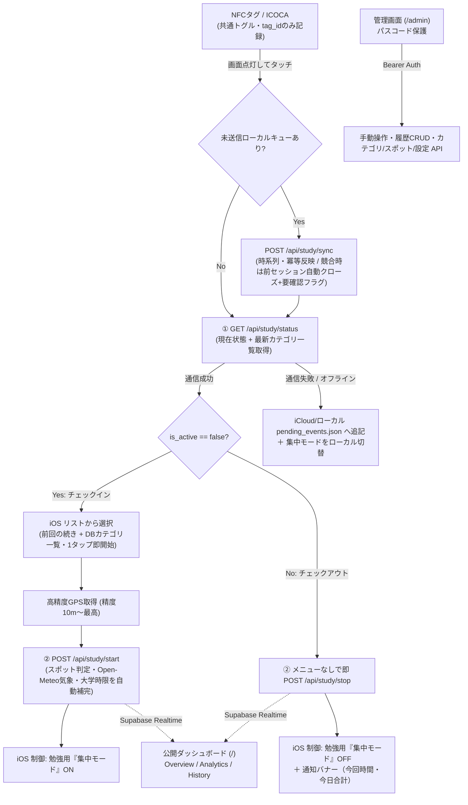

# YPT for me — 技術仕様書（完全版）

## 1. 設計方針

- **単一ユーザー前提**: 完全自分専用として設計し、複雑なマルチテナント認証を排除して開発・運用コストを最小化する。
- **インフラ分離**: 専用の新規 Supabase プロジェクト ＋ 独立 Next.js リポジトリ ＋ Vercel でクリーンに運用する。
- **記録スコープ**: 勉強・作業セッション専用（`app_settings` + `categories` + `spots` + `study_sessions`）。生活ログ等は必要になったタイミングで別テーブルとして拡張する。
- **DB を Single Source of Truth にする + オフライン完全耐性**:
  - 通常時は Supabase で状態を一元管理。
  - オフライン時は iPhone ローカルへイベントをキュー保存しつつ集中モードを切り替え、次回オンライン時に `POST /api/study/sync` で時系列・冪等反映する。
- **iPhone 側を軽く、サーバー側でリッチに補完**:
  - iPhone から送るのは `tag_id` と高精度 GPS（緯度・経度）のみ。
  - スポット名判定（入れ子対応）、天気・気温・気圧（Open-Meteo）、曜日・祝日・大学時限タグはすべてサーバー側で自動補完する。
- **画面分離とプライバシー保護**:
  - **公開ダッシュボード（`/`）**: 読み取り専用・完全公開（別端末閲覧＆LTライブデモ向け）。**緯度・経度（`latitude`, `longitude`）や `spots` の座標定義は公開 API / UI に一切返却しない**。
  - **管理画面（`/admin`）**: パスコード（`API_SECRET`）保護。手動操作・履歴CRUD・要確認セッション補正・カテゴリ管理・スポット管理（未登録座標からの逆引き登録＆過去ログ一括再判定）・アプリ設定をすべて集約する。

---

## 2. システムアーキテクチャ



---

## 3. データベース設計（Supabase / PostgreSQL）

### 3.1 `app_settings` テーブル（シングルトン設定）

`/admin` の Settings タブからコード変更なしで調整できる運用設定。`id = 1` の1行のみ保持する。

| カラム名 | 型 | デフォルト | 説明 |
| :--- | :--- | :--- | :--- |
| `id` | `int4` | PK, `check (id = 1)` | シングルトン固定 ID |
| `day_boundary_hour` | `int4` | `4` | 1日の日付境界（JST、0〜6時。4なら 0:00〜3:59 は前日計上） |
| `streak_min_minutes` | `int4` | `30` | Streak（連続達成日数）をカウントする1日あたり最低勉強分数 |
| `daily_goal_weekday_min` | `int4` | `180` | 平日の1日目標勉強時間（分） |
| `daily_goal_weekend_min` | `int4` | `360` | 土日祝の1日目標勉強時間（分） |
| `long_session_warn_min` | `int4` | `360` | 終了し忘れ警告を出す経過分数（6時間） |
| `univ_periods` | `jsonb` | 下記デフォルト JSON | 大学時限の時刻レンジ定義（JST `HH:MM`） |
| `updated_at` | `timestamptz` | `now()` | 最終更新日時 |

**`univ_periods` デフォルト値（`/admin` から大学時間割に合わせて調整可）**:
```json
[
  { "key": "morning", "label": "朝", "start": "04:00", "end": "08:50" },
  { "key": "period_1", "label": "1限", "start": "08:50", "end": "10:20" },
  { "key": "period_2", "label": "2限", "start": "10:30", "end": "12:00" },
  { "key": "lunch", "label": "昼休み", "start": "12:00", "end": "13:00" },
  { "key": "period_3", "label": "3限", "start": "13:00", "end": "14:30" },
  { "key": "period_4", "label": "4限", "start": "14:40", "end": "16:10" },
  { "key": "period_5", "label": "5限", "start": "16:20", "end": "17:50" },
  { "key": "after_school", "label": "放課後", "start": "17:50", "end": "23:00" },
  { "key": "late_night", "label": "深夜", "start": "23:00", "end": "04:00" }
]
```

### 3.2 `categories` テーブル

| カラム名 | 型 | 制約 | 説明 |
| :--- | :--- | :--- | :--- |
| `id` | `uuid` | PK, `default gen_random_uuid()` | カテゴリ ID |
| `name` | `text` | `not null`, `unique` | 表示名 |
| `color` | `text` | `not null` | HEX カラーコード |
| `sort_order` | `int4` | `not null`, `default 0` | 表示順 |
| `is_archived` | `boolean` | `not null`, `default false` | アーカイブフラグ |
| `created_at` | `timestamptz` | `not null`, `default now()` | 作成日時 |

**初期シードデータ（5トラック準拠）**:
1. `大学講義・課題` (`#3B82F6`)
2. `個人開発・A4` (`#10B981`)
3. `資格（FE等）` (`#F59E0B`)
4. `英語` (`#8B5CF6`)
5. `その他` (`#6B7280`)

### 3.3 `spots` テーブル

高精度 GPS から場所ラベルを自動判定するためのマスタテーブル。**座標データは完全非公開（`/admin` 認証時のみ取得・編集可）**。

| カラム名 | 型 | 制約 | 説明 |
| :--- | :--- | :--- | :--- |
| `id` | `uuid` | PK, `default gen_random_uuid()` | スポット ID |
| `name` | `text` | `not null`, `unique` | 公開用場所ラベル（例: `Home`, `大学図書館`, `サークル部屋`, `カフェA`） |
| `spot_group` | `text` | `not null`, `default 'Other'` | 大分類（`Home` / `Univ` / `Cafe` / `Other`） |
| `latitude` | `double precision` | `not null` | 中心緯度（非公開） |
| `longitude` | `double precision` | `not null` | 中心経度（非公開） |
| `radius_m` | `int4` | `not null`, `default 50` | 判定半径（メートル） |
| `wifi_ssid` | `text` | nullable | 紐づける Wi-Fi SSID（カンマ区切りで複数指定可・**完全非公開**） |
| `created_at` | `timestamptz` | `not null`, `default now()` | 作成日時 |

**スポットの判定優先ルール**:
- **Wi-Fi SSID 一致を最優先**: セッションに `wifi_ssid` が含まれ、登録スポットの `wifi_ssid`（カンマ区切り）と一致すれば GPS より優先して採用（複数一致時は最小 `radius_m` 優先）。
- 一致する Wi-Fi がない場合、距離（Haversine）が `radius_m` 以下となるスポットをすべて抽出。
- **最も `radius_m` が小さい（より限定的な）スポットを優先**（例: `大学キャンパス(300m)` より `大学図書館(40m)` を優先）。
- 同じ `radius_m` の場合は中心座標からの距離が近い方を採用。

### 3.4 `study_sessions` テーブル

| カラム名 | 型 | 制約 | 説明 |
| :--- | :--- | :--- | :--- |
| `id` | `uuid` | PK, `default gen_random_uuid()` | セッション ID |
| `category_id` | `uuid` | FK → `categories(id)`, `not null` | カテゴリ ID |
| `spot_id` | `uuid` | FK → `spots(id)`, nullable | 判定されたスポット ID |
| `location_label` | `text` | `not null`, `default 'Other'` | 公開用場所ラベル |
| `memo` | `text` | nullable | 任意の作業メモ（`/admin` から追記・編集） |
| `tag_id` | `text` | nullable | トリガー識別子（`pc_palmrest`, `icoca_main`, `web_manual` 等） |
| `wifi_ssid` | `text` | nullable | 打刻時の接続中 Wi-Fi SSID（**公開 API / UI に返却しない**） |
| `latitude` | `double precision` | nullable | 打刻時の緯度（**公開 API / UI に返却しない**） |
| `longitude` | `double precision` | nullable | 打刻時の経度（**公開 API / UI に返却しない**） |
| `weather_code` | `int4` | nullable | WMO 天気コード（Open-Meteo 自動補完） |
| `temperature_c` | `real` | nullable | 気温 ℃ |
| `pressure_hpa` | `real` | nullable | 気圧 hPa |
| `pressure_diff_3h` | `real` | nullable | 3時間前比の気圧変化量 hPa（Open-Meteo 自動補完） |
| `pressure_diff_6h` | `real` | nullable | 6時間前比の気圧変化量 hPa（Open-Meteo 自動補完） |
| `day_type` | `text` | nullable | `weekday` / `weekend` / `holiday`（JST 基準） |
| `univ_period` | `text` | nullable | `morning` / `period_1`〜`period_5` / `lunch` / `after_school` / `late_night` |
| `needs_review` | `boolean` | `not null`, `default false` | 要確認フラグ（オフライン競合での自動クローズ時や異常検知時に `true`） |
| `start_event_id` | `text` | unique, nullable | オフライン同期・二重送信防止用の冪等キー（開始） |
| `stop_event_id` | `text` | unique, nullable | オフライン同期・二重送信防止用の冪等キー（終了） |
| `started_at` | `timestamptz` | `not null`, `default now()` | 開始時刻（UTC保存） |
| `ended_at` | `timestamptz` | nullable | 終了時刻（`NULL` は現在計測中） |
| `duration_sec` | `int4` | nullable | 確定経過秒数 |
| `created_at` | `timestamptz` | `not null`, `default now()` | レコード作成日時 |

### 3.5 インデックス & 制約設計

```sql
-- DBレベルで「計測中（ended_at IS NULL）は最大1件」を保証
create unique index study_sessions_single_active_idx
  on study_sessions ((1))
  where ended_at is null;

-- 集計・履歴検索用インデックス
create index study_sessions_started_at_idx on study_sessions (started_at desc);
create index study_sessions_category_id_idx on study_sessions (category_id);
create index study_sessions_spot_id_idx on study_sessions (spot_id);
create index study_sessions_needs_review_idx on study_sessions (needs_review) where needs_review = true;
```

### 3.6 RLS & プライバシー方針

- 全テーブルで **RLS を有効化**し、`app_settings` / `categories` / `spots` / `study_sessions` への `anon` アクセスを全面禁止（すべてサーバー側 `service_role` 経由でアクセス）。
- 公開ダッシュボードのデータ取得は Next.js サーバー側で `service_role` 経由取得し、**`latitude` / `longitude` および `spots` の座標カラムを完全に除外した DTO** のみを返却する。
- **プライバシー安全な Realtime 通知（`study_realtime_signals`）**: `study_sessions` の変更時にトリガーで 1 行のタイムスタンプ専用テーブル `study_realtime_signals` のみを更新し、このテーブルだけ `anon` 読み取り許可＋`supabase_realtime` publication へ登録する。公開クライアントは更新イベントを受け取ったら `/api/dashboard` を再フェッチすることで、座標カラムを一切露出せずにリアルタイム更新を実現する。

---

## 4. API 仕様（Next.js App Router）

### 認証方式
- iOS ショートカット用および `/admin` 用エンドポイントは `Authorization: Bearer <API_SECRET>` を検証（不正時は `401 Unauthorized`）。

### 4.1 iOS ショートカット用 API

| Method & Path | 認証 | 概要 |
| :--- | :--- | :--- |
| `GET /api/study/status` | 必須 | 現在の計測状態（`is_active` / `active_session`）と、待機時は `last_category` + 有効な `categories` 一覧を返す |
| `POST /api/study/start` | 必須 | 計測開始。`client_event_id` で冪等チェック → 入れ子スポット判定 → Open-Meteo 気象補完（2秒タイムアウト・非ブロッキング）→ JST 曜日/祝日/大学時限判定 → `INSERT` |
| `POST /api/study/stop` | 必須 | 計測終了。`ended_at` と `duration_sec` を更新し、日付境界（`day_boundary_hour`）基準の当日合計分数を返す |
| `POST /api/study/sync` | 必須 | オフラインキュー配列（`events[]`）を `occurred_at` 昇順で冪等適用。既に計測中の状態で新しい `start` が来た場合は、前のセッションを新 `start` 時刻で自動クローズし `needs_review = true` を付与して続行 |

### 4.2 公開ダッシュボード用 API（読み取り専用・座標非公開）

| Method & Path | 認証 | 概要 |
| :--- | :--- | :--- |
| `GET /api/dashboard` | 不要 | アクティブセッション、当日合計＆Daily Goal進捗、Streak、期間別カテゴリ集計、公開用直近履歴を返す |
| `GET /api/analytics` | 不要 | GitHub草カレンダー、曜日×時間帯ヒートマップ、大学時限別集計、スポット別集計、天気・気圧帯別集計を返す |

### 4.3 Admin 管理用 API（すべて Bearer 認証必須）

| Method & Path | 概要 |
| :--- | :--- |
| `POST /api/admin/verify` | パスコード検証用（`/admin` ログイン画面で使用） |
| `GET /api/admin/sessions` | `needs_review` フィルタや未登録スポット（`spot_id IS NULL` かつ座標あり）フィルタ対応のセッション一覧 |
| `POST /api/admin/sessions` | 手動セッション追加 |
| `PATCH /api/admin/sessions/[id]` | 時刻修正（`duration_sec` 再計算）・カテゴリ/スポット変更・メモ追記・`needs_review` 解除 |
| `DELETE /api/admin/sessions/[id]` | 誤打刻や LT デモ用セッションの削除 |
| `GET / POST / PATCH /api/admin/categories` | カテゴリ一覧取得・追加・色/名前/並び順変更・アーカイブ |
| `GET / POST / PATCH / DELETE /api/admin/spots` | スポット CRUD（座標含む） |
| `POST /api/admin/spots/[id]/reapply` | 新規/編集したスポット条件で、過去の未登録（または全）セッションのスポット判定を一括再適用 |
| `GET / PATCH /api/admin/settings` | `app_settings`（日付境界・Streak条件・目標時間・大学時限・長時間警告しきい値）の取得・更新 |

---

## 5. iOS ショートカット仕様

- **トリガー**: NFC オートメーション（「即座に実行」ON、「実行時に通知」OFF）。どのタグも同じショートカットを呼び出し、`tag_id` だけ引数として渡す。
- **ローカル保存先**: iCloud Drive 内 `Shortcuts/ypt-for-me/pending_events.json`（未送信キュー）および `categories_cache.json`（オフライン時でもカテゴリ選択できるようにするキャッシュ）。
- **チェックイン時（オンライン）**:
  1. `pending_events.json` が空でなければ `POST /api/study/sync` で先に同期し、成功分をキューから削除。
  2. `GET /api/study/status` を実行し、カテゴリ一覧を `categories_cache.json` へ保存。
  3. `🔄 前回の続き（<last_category>）` を先頭にしたリストから **1タップ選択 → 即開始（メモなし）**。
  4. 高精度位置情報（精度 10m〜最高）を取得 → `POST /api/study/start`。
  5. 勉強用 **「集中モード」ON**。
- **チェックアウト時（オンライン）**:
  1. メニューなしで即 `POST /api/study/stop`。
  2. 勉強用 **「集中モード」OFF**。
  3. 通知バナー表示：`お疲れ様！〇〇分集中しました（今日合計 〇〇時間〇〇分）`。
- **オフライン / 通信エラー時**:
  - `pending_events.json` に `{ client_event_id, type, category_id, tag_id, latitude, longitude, occurred_at }` を追記。
  - ローカルの集中モードを切り替え、通知バナーで「オフライン保存しました（次回自動同期）」を表示。

---

## 6. 画面・UI 設計

- **テーマ**: ダークモード基調（ヘッダーにライト/ダーク切替トグルを配置）。

### 6.1 公開ダッシュボード（`/`）
タブ構成（`Overview` / `Analytics` / `History`）＋ ヘッダーにテーマ切替と `/admin` への控えめなリンク。

- **Overview タブ**:
  - **アクティブタイマーカード**: 秒単位リアルタイムカウントアップ、カテゴリ色バッジ、場所ラベル、天気・気温アイコン。**LT 投影用の全画面拡大ボタン**付き。
  - **サマリー KPI**: 今日の合計時間 ＋ **Daily Goal プログレスバー**（平日/土日祝を自動判定）、**Streak（連続達成日数）**、今週の合計。
  - **今日のカテゴリ別内訳**: カラーバー＆時間一覧。
- **Analytics タブ**:
  - **GitHub草スタイル カレンダー**（日別勉強量の濃淡）
  - **曜日 × 時間帯（0〜23時）ヒートマップ**
  - **大学時限別グラフ**（朝 / 1〜5限 / 昼 / 放課後 / 深夜）
  - **スポット別比較**（合計時間・1セッション平均時間）
  - **天気・気圧帯別比較**（晴れ/曇り/雨、低気圧 `< 1005hPa` vs 通常）
- **History タブ**:
  - 日付・カテゴリ・スポットで絞り込めるセッション履歴一覧（座標非表示）。

### 6.2 管理画面（`/admin`）
未認証時はパスコード入力画面のみ表示（成功後は `localStorage` に保持、ログアウトボタン付き）。

- **Control**: 手動 Start / Stop（カテゴリ・スポット・メモ選択可）、**要確認アラート**（6時間超計測中セッション・`needs_review = true` のセッションを最上部に表示して即補正）。
- **Sessions**: セッション一覧の時刻修正・メモ追記・カテゴリ/スポット変更・手動追加・削除（LTデモセッションのワンクリック削除含む）。
- **Categories**: 科目の追加・色変更・並び替え・アーカイブ。
- **Spots**: スポット一覧・追加・編集・削除。**「未登録座標のセッション一覧」から 1クリックで名前＋半径を指定して新スポット登録＆過去ログ一括再判定**。
- **Settings**: 日付境界（デフォルト4時）、Streak最低分数（デフォルト30分）、平日/休日目標時間、長時間警告しきい値、大学時限レンジの編集。

---

## 7. ディレクトリ構成案（Next.js App Router）

```text
src/
├── app/
│   ├── page.tsx                  # 公開ダッシュボード (/)
│   ├── admin/
│   │   └── page.tsx              # 管理画面 (/admin)
│   └── api/
│       ├── dashboard/route.ts    # 公開 Overview / History 用
│       ├── analytics/route.ts    # 公開 Analytics 用
│       ├── study/
│       │   ├── status/route.ts   # iOS: 状態＋カテゴリ取得
│       │   ├── start/route.ts    # iOS: 開始打刻（補完付き）
│       │   ├── stop/route.ts     # iOS: 終了打刻
│       │   └── sync/route.ts     # iOS: オフラインキュー同期
│       └── admin/
│           ├── verify/route.ts
│           ├── sessions/route.ts
│           ├── sessions/[id]/route.ts
│           ├── categories/route.ts
│           ├── spots/route.ts
│           ├── spots/[id]/reapply/route.ts
│           └── settings/route.ts
├── components/
│   ├── dashboard/                # TimerCard, KpiSummary, CategoryBreakdown, AnalyticsCharts, HistoryList
│   └── admin/                    # AdminGate, ManualControl, ReviewBanner, SessionManager, CategoryManager, SpotManager, SettingsForm
└── lib/
    ├── supabase/                 # server.ts (service_role), client.ts (anon/realtime)
    ├── auth.ts                   # Bearer トークン検証
    ├── geo.ts                    # Haversine距離計算 & 入れ子スポット判定
    ├── weather.ts                # Open-Meteo 気象データ取得（タイムアウト付き）
    ├── time.ts                   # JST日付境界計算・祝日判定・大学時限判定・Streak算出
    └── types.ts                  # 共有型定義（公開DTO / Admin DTO）
supabase/
└── migrations/
    ├── 20261125011957_init_schema.sql             # テーブル・インデックス・RLS・初期シード
    └── 20261125012619_harden_triggers_and_updated_at.sql
```
